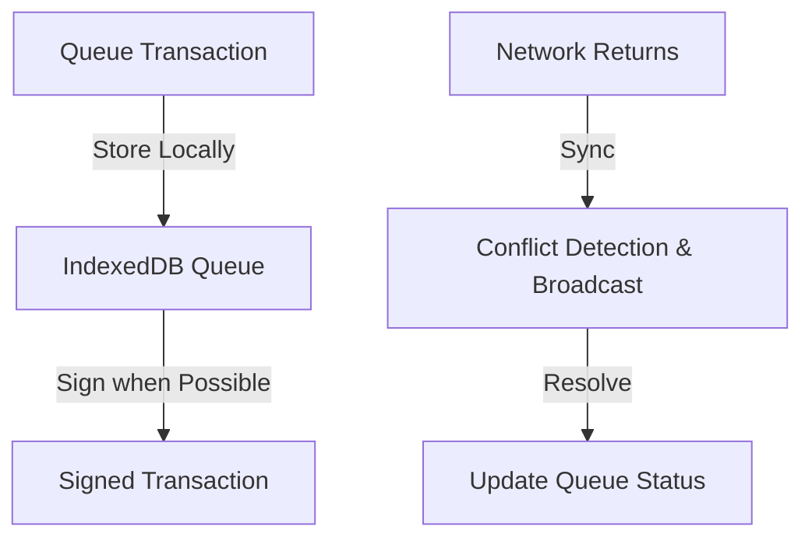

# wax-offline-transaction-queue — Offline-First Transaction Queue & Sync

> **Status:** 🔒 Private (In Development) | Target Public Release: August 2026  
> **Category:** Performance & Optimization  
> **Parent Catalog:** [pixel-journey/wax-ecosystem-blueprint-catalog](https://github.com/pixel-journey/wax-ecosystem-blueprint-catalog)

**One-sentence goal:** A robust offline-first transaction queue that allows users to queue, sign, and prepare WAX transactions even when offline or on poor connections, with intelligent sync, conflict resolution, and retry logic when connectivity returns.

---

## 1. Overview & Goal

This blueprint makes WAX interactions resilient to network issues. Users can continue working offline and sync seamlessly later.

- **Why it matters for WAX:** Mobile and global users often face unreliable connections. Offline capability dramatically improves reliability and user confidence.
- **Public infrastructure only:** Local storage (IndexedDB), WharfKit or similar for signing, standard WAX RPC for eventual broadcast. No custom contracts.
- **Target users:** Mobile users, travelers, users in regions with poor connectivity, power users who batch actions.
- **Success metrics:** "Queue and sign transactions offline with zero data loss", "Seamless sync and conflict handling on reconnect", "Reliable experience even on flaky networks".

---

## 2. Concepts & Inspiration

- **Core concepts:** Queue actions locally while offline. Sign when possible. On reconnect, intelligently broadcast, handle nonces, detect conflicts (e.g. same asset used), and retry with exponential backoff.
- **Pain points:** Transactions fail silently on poor connections. Users lose progress or have to retry manually.
- **Inspirations:** Offline-first apps (e.g. Linear, Notion), optimistic UI patterns, modern sync engines. Web3: offline signing + smart sync for blockchain actions.
- **Cross-references:** Complements performance blueprints like `wax-progressive-nft-metadata-hydration-grid` and `wax-ipfs-gateway-speed-test-matrix`. Fits with any interactive or gaming tools.

---

## 3. Design Specifications (Pixel Journey Standards)

### 3.1 Visual & Interaction Design
- Clean queue panel showing pending, signed, and synced transactions.
- Status indicators: Offline mode banner, sync progress, conflict warnings.
- Micro-interactions: Smooth add to queue, satisfying sync animation, clear error states with retry options.
- Responsive: Full featured on desktop; excellent mobile experience with offline banner.

### 3.2 Key Views / Components
- `OfflineQueue.tsx` — Main queue management interface.
- `TransactionCard.tsx` — Rich card showing action details, status, and retry options.
- `SyncControls.tsx` — Manual sync trigger, conflict resolution UI.
- `ConflictModal.tsx` — Clear explanation and resolution options for conflicts.
- `OfflineBanner.tsx` — Persistent but non-intrusive offline status indicator.

### 3.3 Accessibility (A11y) & Inclusive Design
- WCAG 2.2 AA: Keyboard navigation, screen reader announcements for queue changes and sync status, high contrast.
- Clear text explanations for all states.

### 3.4 Performance & Optimization Targets
- Efficient local storage with IndexedDB.
- Fast sync with batching where possible.
- Graceful handling of large queues.

---

## 4. Technical Architecture

### 4.1 Core Tech Stack
- Next.js 15 + TypeScript + Tailwind + shadcn/ui
- IndexedDB (via idb or similar) for offline queue storage
- WharfKit or @wharfkit/session for signing
- Standard WAX RPC for broadcast
- Simple conflict detection logic (nonce, asset state)

### 4.2 Data Flow Diagram


### 4.3 Folder Structure
```
app/
├── components/
│   ├── queue/
│   │   ├── OfflineQueue.tsx
│   │   └── TransactionCard.tsx
│   └── sync/
│       └── SyncControls.tsx
├── hooks/useOfflineQueue.ts
├── lib/
│   ├── storage/
│   │   └── queue-storage.ts
│   └── wax/
│       └── sync-engine.ts
└── types/queue.ts
```

### 4.4 Security & Privacy
- Signing happens locally. No private keys leave the device.
- Queue is user-controlled and can be cleared.

---

## 5. Implementation Examples & Code Snippets

**Core offline queue hook**
```ts
// hooks/useOfflineQueue.ts
export function useOfflineQueue() {
  const [queue, setQueue] = useState<Transaction[]>([]);

  const addToQueue = (action: any) => {
    // Store in IndexedDB and update state
  };

  const syncQueue = async () => {
    // Broadcast pending, handle conflicts
  };

  return { queue, addToQueue, syncQueue };
}
```

**Sync logic (high-level)**
```ts
async function syncQueue() {
  for (const tx of pending) {
    try {
      await broadcast(tx);
    } catch (e) {
      if (isConflict(e)) handleConflict(tx);
    }
  }
}
```

---

## 6. Demo & Testing
- Demo mode with simulated offline/online toggles.
- Interaction tests: queue actions, sign, sync, conflict resolution.
- Edge cases for nonce conflicts, asset state changes, large queues.
- Performance tests for sync speed.

---

## 7. Roadmap
Phases: Local storage queue + signing → Sync engine with conflict detection → UI polish, offline banner, a11y → full documentation.

Future: Background sync (Service Worker), multi-device sync hints, integration with other performance tools.

---

## 8. Visual References
> Clean offline-first UIs like Linear or modern progressive web apps, with clear status and satisfying sync. Professional yet approachable. Reference: high-quality offline-capable web apps.

---

## 9. Related Blueprints
- `wax-progressive-nft-metadata-hydration-grid` & `wax-ipfs-gateway-speed-test-matrix` — Performance synergy.
- Any interactive or mobile-first blueprints.

---

## 10. License & Credits
MIT. Built for reliable WAX experiences even on unreliable networks.

**Pixel Journey — Beautiful interfaces for public blockchain data.**
